<!-- tailor:social-header:start -->
<p align="center">
  <a href="https://wonkey.wimpys.world"><picture><source media="(prefers-color-scheme: dark)" srcset="pages/social/hero-dark.svg"></picture></a>
</p>
<!-- tailor:social-header:end -->

<!-- tailor:social-links:start -->
<p align="center">
  <a href="https://bsky.app/profile/wimpys.world"><picture><source media="(prefers-color-scheme: dark)" srcset="pages/social/link-bluesky-dark.svg"></picture></a>
  <a href="https://wimpysworld.social/@martin"><picture><source media="(prefers-color-scheme: dark)" srcset="pages/social/link-mastodon-dark.svg"></picture></a>
  <a href="https://linkedin.com/in/martinwimpress"><picture><source media="(prefers-color-scheme: dark)" srcset="pages/social/link-linkedin-dark.svg"></picture></a>
</p>
<!-- tailor:social-links:end -->

<!-- tailor:social-community:start -->
<p align="center">
  <a href="https://discord.com/invite/vUsydfP"><picture><source media="(prefers-color-scheme: dark)" srcset="https://raw.githubusercontent.com/wimpysworld/WonKey/social-assets/community-dark.svg"></picture></a>
</p>
<!-- tailor:social-community:end -->

Configure USB macropads and mini-keyboards from one Linux CLI. Inspect connected pads with `wonkey`, bind keys, rotary knobs, multi-stroke macros, consumer media controls, and relative mouse actions, and set RGB or LED lighting.

## Features

- **Automatic discovery and readback**: inspect connected XFKEY, CH57x, and SayoDevice macropads with their USB paths, layouts, supported commands, and current settings.
- **Keys, knobs, layers, and triggers**: bind single keys or modifier chords (`ctrl+`, `shift+`, `alt+`, `super+`) to buttons, rotary knobs, and layers, and configure press or release triggers on supported pads.
- **Macros, media, and mouse actions**: assign comma-separated key sequences, consumer media controls, mouse buttons, relative cursor movement, and scroll wheel ticks.
- **RGB and LED lighting**: configure 24-bit RGB modes and hex colours with `wonkey rgb`, or LED backlight modes (`off`, `reactive`, `cycle`) with `wonkey led`.
- **Official SayoDevice firmware**: check firmware versions against the vendor manifest, update firmware, and recover devices in bootloader mode with `wonkey firmware`.
- **Guarded writes**: validate device capabilities and descriptors before every write, and skip unchanged writes on XFKEY One Key Max.

<!-- tailor:social-stats:start -->
<p align="center">
  <a href="https://github.com/wimpysworld/WonKey/pulse"><picture><source media="(prefers-color-scheme: dark)" srcset="https://raw.githubusercontent.com/wimpysworld/WonKey/social-assets/stats-dark.svg"></picture></a>
</p>
<!-- tailor:social-stats:end -->

## Install

First-party signed package repositories are published for Linux through [wimpys.world](https://wimpys.world/). Choose your distribution below for setup instructions and automatic updates.

<!-- tailor:social-packages:start -->
<p align="center">
  <a href="https://apt.wimpys.world/#wonkey"><picture><source media="(prefers-color-scheme: dark)" srcset="pages/social/pkg-apt-dark.svg"></picture></a>
  <a href="https://rpm.wimpys.world/#wonkey"><picture><source media="(prefers-color-scheme: dark)" srcset="pages/social/pkg-rpm-dark.svg"></picture></a>
  <a href="https://pkg.wimpys.world/#wonkey"><picture><source media="(prefers-color-scheme: dark)" srcset="pages/social/pkg-pkg-dark.svg"></picture></a>
  <br>
  <a href="https://apk.wimpys.world/#wonkey"><picture><source media="(prefers-color-scheme: dark)" srcset="pages/social/pkg-apk-dark.svg"></picture></a>
  <a href="https://nix.wimpys.world/#wonkey"><picture><source media="(prefers-color-scheme: dark)" srcset="pages/social/pkg-nix-dark.svg"></picture></a>
</p>
<!-- tailor:social-packages:end -->

<details>
<summary><strong>Any Linux (<code>bin</code>)</strong> - install and update the release binary directly</summary>

[bin](https://github.com/marcosnils/bin) installs and updates the release binary:

```sh
bin install github.com/wimpysworld/WonKey
```

</details>

<details id="build-from-source">
<summary><strong>Build from source</strong> - compile locally with Go 1.25 or later and <code>just</code></summary>

Requires Git, Go 1.25 or later, and [just](https://just.systems/).

```sh
just build
sudo install -m 0755 ./bin/wonkey /usr/local/bin/wonkey
```

</details>

<!-- tailor:social-sponsors:start -->
<p align="center">
  <a href="https://github.com/sponsors/flexiondotorg"><picture><source media="(prefers-color-scheme: dark)" srcset="pages/social/sponsors-dark.svg"></picture></a>
</p>
<!-- tailor:social-sponsors:end -->

### Device permissions

Your user needs a `udev` `uaccess` rule to access the macropad's USB or vendor `hidraw` device node. Follow [Device selection and access](wiki/hardware.md#device-selection-and-access) to add a rule for your verified device without running `wonkey` as `root`.

## Quick start

Inspect connected macropads and read current settings without changing them:

```sh
wonkey
```

`wonkey` lists each connected macropad with its `[N]` device number, USB path, layout where readable, supported commands, and readable settings. When multiple macropads are connected, pass `--device <N>` to target device `[N]` (for example `wonkey key f13 --device 2`).

<!-- tailor:social-demo:start -->
<p align="center">
  <picture><source media="(prefers-color-scheme: dark)" srcset="pages/social/demo-dark.svg"></picture>
</p>
<!-- tailor:social-demo:end -->

Bind keys, rotary knobs, and key triggers:

```sh
wonkey key f13
wonkey key ctrl+shift+a
wonkey key key2 f13
wonkey key knob-press mute --layer 2
wonkey trigger release
```

Combine a base key with optional `ctrl+`, `shift+`, `alt+`, or `super+` modifiers. On multi-control pads, pass an optional control name (`key1`..`key12`, `knob-left`, `knob-press`, `knob-right`, `knob1-left`..`knob4-right`) and `--layer <N>`, or use `wonkey trigger <press|release|both>` on single-key pads that support triggers.

Bind relative mouse actions, consumer media controls, or multi-stroke macros:

```sh
wonkey mouse left+right --x -20 --y 10
wonkey mouse wheelup
wonkey media playpause
wonkey media knob-right volumeup
wonkey macro a,f13,enter --interval 50 --repeat 2
wonkey macro key3 ctrl+c,ctrl+v --layer 2
```

Assign mouse buttons, relative cursor movement, wheel ticks, media keys, or comma-separated key sequences to any supported button or rotary knob.

Set RGB lighting or LED backlight modes:

```sh
wonkey rgb static 0000ff
wonkey rgb off
wonkey led reactive
wonkey led cycle
wonkey led off
```

Use `wonkey rgb` for 24-bit RGB modes and hex colours on XFKEY and SayoDevice macropads, or `wonkey led` for LED backlight modes (`off`, `reactive`, `cycle`) on CH57x macropads.

Check or update official vendor firmware on SayoDevice macropads:

```sh
wonkey firmware
wonkey firmware check
wonkey firmware update
```

`wonkey firmware` checks the device's firmware version against the official SayoDevice vendor manifest without modifying the pad. `wonkey firmware update` downloads and installs the latest official vendor firmware or recovers a device in bootloader mode. After the flash, it waits up to 60 seconds for the device to restart, then confirms the model and firmware version with one `Info` query. When the restart or the version is not confirmed, the command prints the next step and exits with status 1.

## Supported devices

| Device | USB ID | Controls | Supported Commands | Settings Readback |
| --- | --- | --- | --- | --- |
| XFKEY One Key Max (`0112`) | `af88:6688` | 1 key | `key`, `trigger`, `macro`, `mouse`, `media`, `rgb` | Full settings readback |
| CH57x Macropad (Gen 1) | `1189:8890`, `514c:8890` | Up to 12 keys, 3 knobs, 15 layers | `key`, `macro`, `mouse`, `media`, `led` | Write-only firmware |
| CH57x Macropad (Gen 2) | `1189` / `514c` : `8830`, `8831`, `8832`, `8833`, `8840`, `8842`, `8850`, `8851` | Up to 12 keys, 4 knobs, 15 layers | `key`, `macro`, `mouse`, `media`, `led` | Layout and Layer 1 bindings |
| SayoDevice Macropad | `8089:0002`, `0003`, `0004`, `0005`, `0009`, `000a`, `000b`, `000c`, `000e` | Up to 12 keys, 4 knobs, 5 layers | `key`, `macro`, `mouse`, `media`, `rgb`, `firmware` | Key bindings, lighting, and firmware version |
| SayoDevice Bootloader (Recovery) | Application PID with product `Bootloader` (`8089:000c` for the 2x3P, confirmed by capture), or manifest `pid2` `8089:0006`, `0007`, `0008`, `0009` for HID v1 directories 2 to 5 (unconfirmed) | Bootloader mode only | `firmware` | Model, firmware version, and `CHECK_FW` reply bytes |

## Documentation

- [Usage and configuration](wiki/usage.md) - Command syntax, supported key and media names, controls, layers, and lighting modes
- [Hardware operations and safety](wiki/hardware.md) - Device permissions, capability rules, hardware verification, and guarded writes
- [Protocol and evidence](wiki/protocol.md) - Packet formats, firmware update protocol, and hardware test records
- [Development](wiki/development.md) - Architecture, quality checks, and test fixtures

## Support and contributing

Read [Support](SUPPORT.md) for help and [Contributing](CONTRIBUTING.md) before submitting a change.

<!-- tailor:social-stars:start -->
<p align="center">
  <a href="https://github.com/wimpysworld/WonKey/stargazers"><picture><source media="(prefers-color-scheme: dark)" srcset="https://raw.githubusercontent.com/wimpysworld/WonKey/social-assets/stars-dark.svg"></picture></a>
</p>
<!-- tailor:social-stars:end -->

<!-- tailor:social-contributors:start -->
<p align="center">
  <a href="https://github.com/wimpysworld/WonKey/graphs/contributors"><picture><source media="(prefers-color-scheme: dark)" srcset="https://raw.githubusercontent.com/wimpysworld/WonKey/social-assets/contributors-dark.svg"></picture></a>
</p>
<!-- tailor:social-contributors:end -->

<!-- tailor:social-footer:start -->
<p align="center">
  <a href="https://tailor.wimpys.world"><picture><source media="(prefers-color-scheme: dark)" srcset="pages/social/footer-dark.svg"></picture></a>
</p>
<!-- tailor:social-footer:end -->
